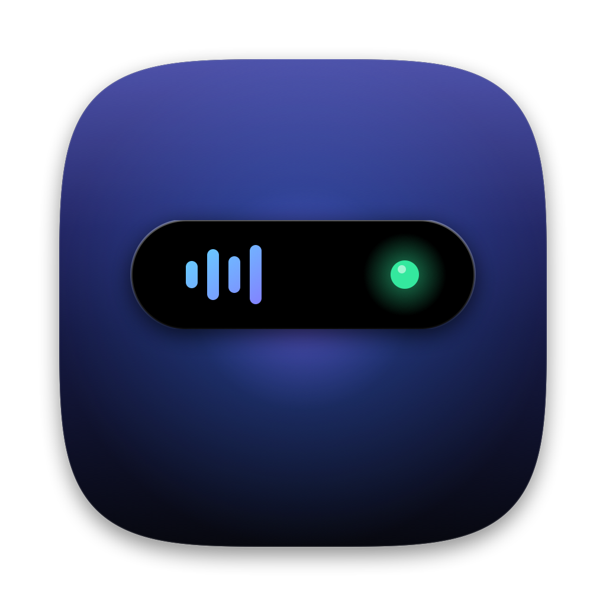
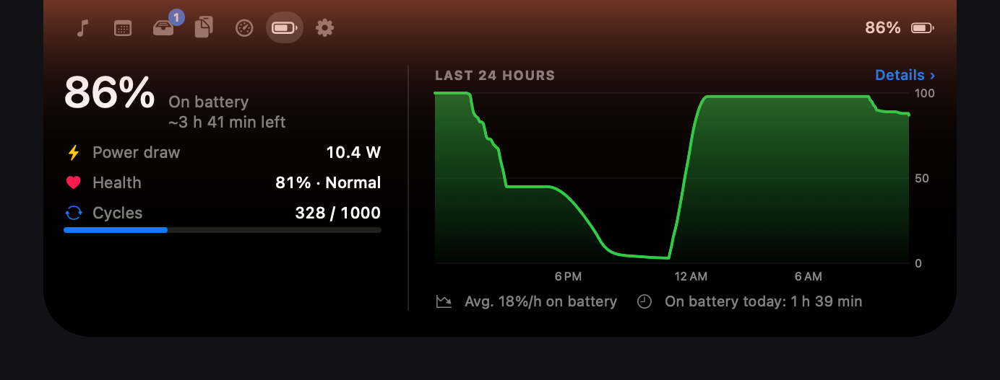
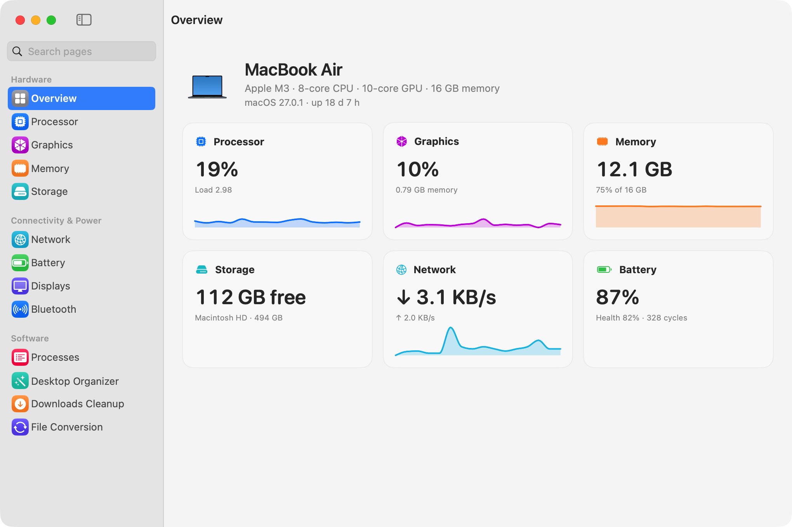

<p align="center">
  
</p>

<h1 align="center">DynIsl</h1>

<p align="center"><strong>Çentiğin artık bir işi var.</strong><br>
MacBook çentiği için canlı bir ada ve eksiksiz bir sistem paneli. Ücretsiz, açık kaynak, Swift ile yazılmış.</p>

<p align="center">
  <a href="https://caganerdal.github.io/DynIsl/"></a>
</p>

<p align="center">
  <a href="https://github.com/caganerdal/DynIsl/releases/latest"></a>
  <a href="https://github.com/caganerdal/DynIsl/actions/workflows/build.yml"></a>
  
  <a href="LICENSE"></a>
</p>

<p align="center"><a href="https://caganerdal.github.io/DynIsl/">Web sitesi</a> · <a href="README.md">English</a> · <strong>Türkçe</strong></p>

<p align="center">
  
</p>

## Neler yapar

Çentiğe gel ya da tıkla, ada açılır. Ne kadar gerekiyorsa o kadar büyür, ayrılınca geri döner.

| | |
|---|---|
| **Müzik** | Spotify ve Apple Music; kapak, ilerleme, kontroller, ses, karışık ve tekrar. Kapak renginde bir parıltı. |
| **Toplantılar** | Takvim etkinliklerinden önce geri sayım; Zoom, Meet, Teams ve Webex için katıl düğmesi. |
| **Pil ve AirPods** | Şarj, sağlık, döngü, son 24 saatin grafiği ve bağlanınca AirPods pili. |
| **AI kullanımı** | Claude'un 5 saatlik ve haftalık limitleri ile yenilenme saatleri; Claude Code token'ları gün, proje ve modele göre; limite yaklaşınca uyarı. |
| **Raf** | Dosyaları adaya bırak, AirDrop'la ya da görselleri JPG'ye çevir, küçült, tek PDF yap, PDF sıkıştır. Hepsi Mac'inde. |
| **Uyanık tut** | Bir süre, bir saate kadar, bir uygulama açıkken, kapak kapalıyken bile. Pil azalınca kendiliğinden kapanır. |
| **Ses ve parlaklık** | Sistemin göstergesinin yerine beş stil: Klasik, Minimal, Halka, Bölmeli, Sıvı. |
| **Pano geçmişi** | Son kopyaladıkların, Mac'inde kalır. Şifre yöneticileri atlanır; ekran kilitlenince silinir. |
| **Canlı bildirimler** | İndirmeler, ekran görüntüleri, Odak modu, internet kopması ve gelmesi, yağmur uyarısı, sistem uyarıları, zamanlayıcı ve çentiğin yanında uyuyan bir kedi. |

<p align="center">
  
</p>

**Sistem paneli:** işlemci (çekirdek çekirdek), grafik, bellek, depolama, ağ ve Wi-Fi, pil sağlığı, ekranlar, Bluetooth ve işlemler (çıkış ve zorla çıkış). Yanında hız testi, masaüstünü türe ve aya göre düzenleme, İndirilenler temizliği ve dosya dönüştürme; hepsi geri alınabilir.

## Kurulum

En son DMG'yi [web sitesinden](https://caganerdal.github.io/DynIsl/) ya da [Sürümler](https://github.com/caganerdal/DynIsl/releases/latest) sayfasından **indir**, aç ve DynIsl'ı Uygulamalar'a sürükle. Developer ID ile imzalı ve Apple onaylı.

macOS 14 Sonoma ve üstü, Apple silicon bir Mac gerekir. En iyisi çentikli bir MacBook; diğer ekranlarda ada menü çubuğunun ortasında durur.

<details>
<summary><strong>Kaynaktan derle</strong></summary>

Xcode ya da Xcode Command Line Tools gerekir (Swift 5.9+).

```bash
git clone https://github.com/caganerdal/DynIsl.git
cd DynIsl
./build-app.sh install
```

`build-app.sh`, `build/DynIsl.app`'i derler; `install` ile `/Applications`'a kopyalar. Apple Development sertifikan varsa onunla imzalar; yoksa izinlerin yeniden derlemelerde korunması için Anahtar Zinciri'nde "DynIsl Local" adlı yerel bir sertifika oluşturur. Developer ID'n varsa `./build-app.sh dmg` onaylı bir DMG üretir.

Kaynaktan kurulumu güncellemek için: `git pull && ./build-app.sh install` ya da Ayarlar'daki **Güncelle** düğmesi.
</details>

## İzinler

Her izin isteğe bağlı. Vermediğin izin sadece o özelliği kapatır.

| İzin | Ne için |
|---|---|
| Otomasyon (Spotify, Müzik) | Çalan şarkıyı göstermek ve kontrol etmek |
| Takvimler | Yaklaşan toplantılar |
| Konum | Hava durumu, yaklaşık 1 km'ye yuvarlanır |
| Bluetooth | AirPods bağlantısı ve pili |
| Erişilebilirlik | Adanın göstergesi için ses ve parlaklık tuşlarını yakalamak |
| Tam Disk Erişimi | Etkin Odak modunu okumak |

## Gizlilik

- Hesap yok, analiz yok. Geçmiş ve ölçümler Mac'inde kalır.
- DynIsl internete yalnızca hava durumu ([Open-Meteo](https://open-meteo.com), yuvarlanmış konumla), Spotify kapakları, GitHub'da günlük güncelleme denetimi (kapatılabilir) ve senin başlattığın hız testleri için çıkar.
- Claude Code kuruluysa AI sekmesi 5 dakikada bir onun `/usage` komutunu senin Claude Code oturumunla çalıştırır; token harcamaz. Claude Code kayıtları yalnızca token sayıları için bilgisayarda okunur, sohbet içeriği okunmaz.
- Pano metinleri bellekte, görseller yalnızca senin hesabının okuyabildiği bir önbellek klasöründe durur. Ekran kilitlenince ve uygulama kapanınca hepsi silinir.
- Ada varsayılan olarak ekran paylaşımında ve kayıtlarda gizlidir.

## Geliştirme

```bash
swift build
swift test
```

`@MainActor` servisleri (müzik, pil, takvim, sistem ölçümü vb.) SwiftUI görünümlerini besler; her görünüm yalnızca gösterdiği servisi izler. CI her push'ta derler ve testleri çalıştırır. Metinler `Resources/Localizable.xcstrings` dosyasında (Türkçe kaynak, İngilizce çeviri); metin ekledikten sonra `./Tools/localize.sh` çalıştır. Bkz. [CONTRIBUTING.md](CONTRIBUTING.md).

Parlaklık kontrolü macOS'un özel `DisplayServices` çerçevesini çalışma anında yükler; DynIsl bu yüzden App Store'da değil. Yüklenemezse tuşlar macOS'a bırakılır.

## Lisans

[MIT](LICENSE)

<sub>Apple, Mac, MacBook ve macOS, Apple Inc.'in ticari markalarıdır. Bu proje Apple ile bağlantılı değildir ve Apple tarafından desteklenmez. Spotify, Spotify AB'nin ticari markasıdır.</sub>
